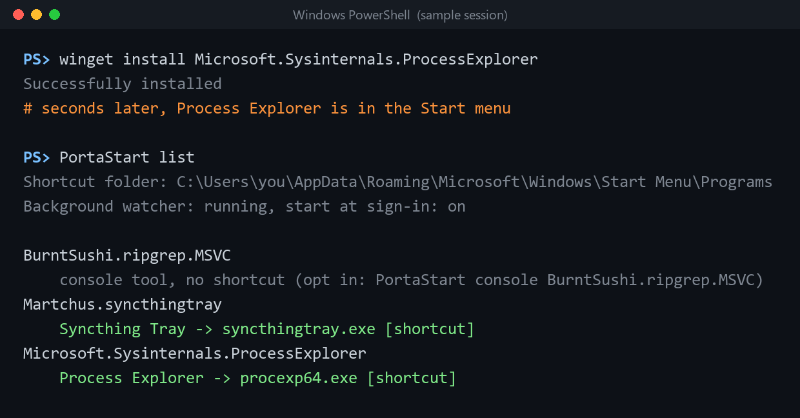

<p align="center"></p>

<h1 align="center">PortaStart</h1>

<p align="center"><b>Start menu shortcuts for portable apps installed with winget.</b><br>
Install with winget, find it in Start. Uninstall, and the shortcut goes too.</p>

<p align="center">
  <a href="https://github.com/BoazCohenJ/PortaStart/releases/latest/download/PortaStart.exe"><b>Download PortaStart.exe</b></a> (87 KB, Windows 10/11)
  · <a href="https://boazcohenj.github.io/PortaStart/">Website</a>
</p>

When winget installs a *portable* package (a zip or a bare exe, like Process Explorer or Syncthing Tray), it puts the program in a folder and a symlink on your PATH, and that's it. There's no Start menu entry, so you can't press <kbd>Win</kbd> and type the name, and app launchers that read the Start menu (Flow Launcher, PowerToys Run) can't find it either. Symlinking winget's `Links` folder into the Start menu doesn't help, because the Start menu ignores symlinks. This has been [winget-cli#2299](https://github.com/microsoft/winget-cli/issues/2299) since 2022.

PortaStart fills the gap until winget does it itself.



## What it does

- **Creates a Start menu shortcut for every GUI app you installed as a winget portable package**, named after the package ("Process Explorer", not "procexp64").
- **Keeps it in sync in the background.** A tiny watcher notices when winget changes its install records and adds, updates or removes shortcuts within about 5 seconds. No window, no tray icon, starts at sign-in.
- **Skips console tools.** `rg`, `fd`, `jq` and friends stay on your PATH and out of your Start menu. Opt a package in with `PortaStart console <id>` if you want it there anyway.
- **Picks the right exe from a zip.** It reads each exe's header, so it ignores uninstallers, updaters and crash handlers, and chooses the x64, ARM64 or x86 build that matches your PC.
- **Never touches shortcuts it didn't make.** If an app already has a Start menu shortcut, or a shortcut with the same name exists, it leaves it alone.
- **Respects your choices.** Delete a shortcut it made and it stays deleted. `PortaStart exclude <id>` keeps a package out for good.
- **Undo is one command.** `PortaStart remove-all` removes every shortcut it made and stops the watcher.

## Get started

1. Download [`PortaStart.exe`](https://github.com/BoazCohenJ/PortaStart/releases/latest/download/PortaStart.exe) and put it somewhere permanent (for example `%LOCALAPPDATA%\Programs\PortaStart\`).
2. Run it: double-click it, or run `PortaStart` in a terminal.

That's all. It creates shortcuts for the portable apps you already have and starts watching for new ones. No admin rights, no installer, nothing to configure. It runs on the .NET Framework 4.8 that ships with Windows 10 and 11.

> **SmartScreen:** the exe isn't code-signed yet, so Windows may say "Windows protected your PC". Click **More info → Run anyway**, or [build it yourself](#build-from-source). The release page has a SHA-256 checksum built by GitHub Actions.

## Commands

| Command | What it does |
|---|---|
| `PortaStart` | Sync now, and keep watching in the background (starts at sign-in, no window) |
| `PortaStart sync [--dry-run]` | Create, update and remove shortcuts once |
| `PortaStart list` | Show your winget portable packages and what each one got |
| `PortaStart exclude <id>` | Never make a shortcut for this package (removes it if present) |
| `PortaStart include <id>` | Undo `exclude`, and bring back a shortcut you deleted |
| `PortaStart console <id>` | Also make shortcuts for this package's console programs |
| `PortaStart folder [name]` | Put the shortcuts in a Start menu folder instead of the top level |
| `PortaStart autostart on\|off` | Turn the background watcher on or off |
| `PortaStart remove-all` | Remove every shortcut PortaStart made and stop watching |
| `PortaStart self-test` | Fake a few winget installs and check that everything works (cleans up after itself) |

Package ids are the ones `winget list` and `PortaStart list` show.

## How it works

winget records each portable install under `HKCU` (or `HKLM` for `--scope machine`) `\Software\Microsoft\Windows\CurrentVersion\Uninstall`, with `WinGetInstallerType = portable`, the exe it installed (`TargetFullPath`) and its folder (`InstallLocation`). PortaStart reads those entries. That's the same data `winget list` and Settings → Apps use, so it doesn't parse winget's logs or manifests.

| Package | What gets a shortcut |
|---|---|
| Single exe | That exe, if it's a GUI program |
| Zip (winget keeps a `<id>.db` index next to it) | The GUI programs in the folder, minus uninstallers, updaters and helpers, narrowed to the build for your CPU and the program named like the package. If there's no clear main program, each one gets a labelled shortcut (at most five). |
| Console program | Nothing, unless you opt it in |

Shortcuts go in your own Start menu (`%APPDATA%\Microsoft\Windows\Start Menu\Programs`), even for machine-wide packages, so it never needs admin rights. A list of the shortcuts it made lives in `%LOCALAPPDATA%\PortaStart\shortcuts.tsv`, and only those are ever changed or removed. Settings live in `config.ini` next to it, and the watcher writes a short `watch.log`.

Every 3 seconds the watcher reads the last-write timestamps of those Uninstall keys (a handful of registry reads; it measured 0 ms of CPU over an idle minute). When they change, it waits until winget has been quiet for two seconds, then syncs. It also does a full sync every 30 minutes just in case. Why not registry change notifications? winget runs as a packaged (MSIX) app, and in testing its registry writes never fired them, while the timestamps always change. The watcher starts at sign-in through your `Run` key, as `conhost.exe --headless PortaStart.exe watch`, which runs it with no window. It uses about 20 MB of private memory.

## FAQ

**Will this conflict with winget if winget adds shortcuts itself one day?**
If winget (or anything else) creates a Start menu shortcut to the same exe, PortaStart sees it and doesn't add its own. Shortcuts it already made stay until you run `PortaStart remove-all`.

**What about packages installed by other package managers (Scoop, Chocolatey)?**
Scoop already makes Start menu shortcuts. PortaStart only looks at winget's portable installs, and it never touches regular installer-based (MSI/EXE) packages, which make their own shortcuts.

**Doesn't Winhance do this?**
For apps you install *through Winhance*, yes: since January 2026 the Winhance tweaking suite creates a Start menu folder with shortcuts to every exe in a portable package it installs. PortaStart works with plain winget (the commands you type, scripts, other front ends), picks the main program instead of every exe, and removes the shortcut when you uninstall.

**Can I put everything in one folder?**
`PortaStart folder "WinGet Apps"`. The shortcuts move there. `PortaStart folder ""` moves them back to the top level, where Windows' own guidelines put single-app shortcuts.

**I deleted a shortcut and want it back.**
`PortaStart include <id>`.

**Does it phone home?**
No. It makes no network connections at all.

## Build from source

Needs the .NET SDK (any version from 6 on can build .NET Framework 4.8 projects on Windows):

```
dotnet test tests/PortaStart.Tests -c Release
dotnet build src/PortaStart -c Release
src\PortaStart\bin\Release\net48\PortaStart.exe self-test
```

The decision logic (which exe gets a shortcut, and what to create, update or delete) is in [`Core.cs`](src/PortaStart/Core.cs), with no Windows calls in it, and is unit tested. That includes the real layouts of the Process Explorer and ripgrep zips. `self-test` checks the platform side end to end: it writes fake winget portable entries and files, then checks that the watcher creates the right shortcuts, skips the console tool and the zip's uninstaller, removes the shortcut on uninstall, and doesn't bring back one you deleted. CI runs both on every push. Before release it was also tested against real `winget install` and `winget uninstall` runs of Process Explorer.

## Why this exists

- [winget-cli#2299, "Add start menu entries for portable applications"](https://github.com/microsoft/winget-cli/issues/2299): open since July 2022, 100+ 👍, still asked about in 2025 and 2026 ("is anybody at all working on implementing this?").
- Related requests: [#4185](https://github.com/microsoft/winget-cli/issues/4185) (automatic shortcuts for portable programs), [#3314](https://github.com/microsoft/winget-cli/issues/3314) (desktop shortcuts), [#4930](https://github.com/microsoft/winget-cli/issues/4930) (closed as a duplicate).
- The winget team has explained why it's hard to do inside winget: manifest format, opt-in versus opt-out, and what upgrades should do. A separate opt-in tool sidesteps all of that.

## License

[MIT](LICENSE) © BoazCohenJ
